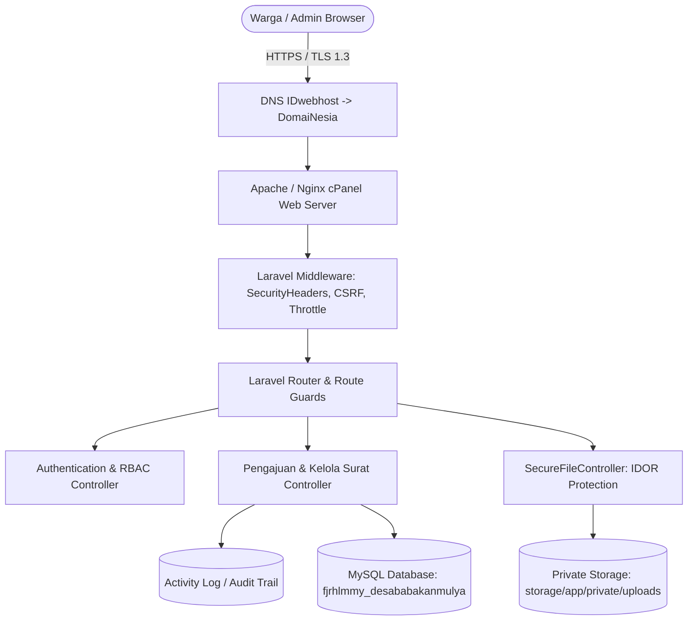

# Sistem Informasi Administrasi Persuratan Desa Babakanmulya
## Proyek Cyber Security (Pra UTS) - Semester 5

[](https://laravel.com)
[](https://php.net)
[](https://tailwindcss.com)
[](https://www.mysql.com)
[](https://fjrhlm.my.id)

---

### Identitas Mahasiswa
* **Nama**: Fajar Halim
* **NIM**: 20240810047
* **Kelas**: TINFC-2024-02
* **Mata Kuliah**: Cyber Security
* **Dosen Pengampu**: Dosen Cyber Security
* **Tahun Akademik**: 2026/2027

---

## 1. Deskripsi Aplikasi
**Sistem Informasi Administrasi Persuratan Desa Babakanmulya** adalah aplikasi web e-government berbasis **Laravel 12** yang dirancang untuk mendigitalisasi dan mengamankan seluruh siklus penerbitan surat keterangan resmi bagi warga desa. 

Sistem ini mentransformasi proses pelayanan manual yang lambat dan rentan tercecer menjadi alur kerja daring yang terstruktur: mulai dari pengajuan mandiri oleh warga, verifikasi berkas oleh perangkat desa, persetujuan kepala desa, hingga penerbitan dan pencetakan surat resmi dalam format PDF ber-kops surat desa. Karena mengelola data kependudukan sensitif (NIK, Kartu Keluarga, dan KTP), aplikasi ini dirancang dengan prinsip **Defense-in-Depth** dan **Secure Coding** untuk memitigasi risiko keamanan siber (OWASP Top 10).

### URL Akses Publik (Production)
* **URL Aplikasi**: [https://fjrhlm.my.id](https://fjrhlm.my.id)
* **Halaman Login**: [https://fjrhlm.my.id/login](https://fjrhlm.my.id/login)
* **Status SSL/TLS**: Valid Let's Encrypt Wildcard Certificate (Grade A HTTPS)

---

## 2. Akun Uji Coba (Testing Credentials)
Dosen dan penguji dapat menggunakan akun-akun berikut untuk menguji fungsionalitas dan aspek keamanan:

| Peran (Role) | Username / Email / NIK | Password | Hak Akses & Cakupan Uji |
| :--- | :--- | :--- | :--- |
| **Administrator Desa** | `admin@desa-babakanmulya.id` *(atau `admin`)* | `admin123` | Akses penuh dashboard aparatur desa, verifikasi berkas, persetujuan status permohonan surat, cetak PDF resmi, serta monitoring Audit Trail (Activity Log). |
| **Warga 1 (User Reguler)** | `3578102105880003` *(atau `fajar@example.com`)* | `123` | Akses dashboard warga, pengajuan surat mandiri (9 jenis surat), upload berkas KTP/KK, monitoring status pengajuan. |
| **Warga 2 (User Pembanding)** | `budi@example.com` | `123` | Akun pembanding untuk menguji celah **Insecure Direct Object Reference (IDOR)** / Broken Access Control pada berkas warga lain. |

---

## 3. Fitur Utama Sistem

1. **Autentikasi & Otorisasi Berbasis Peran (RBAC)**:
   * Pemisahan ketat hak akses antara Administrator Desa dan Warga.
   * Kebijakan kata sandi kuat (*Password Hardening*) dan proteksi Brute Force Login.
2. **Pengajuan Surat Mandiri (Citizen Self-Service)**:
   * Melayani 9 jenis surat keterangan resmi:
     1. Surat Keterangan Tidak Mampu (SKTM)
     2. Surat Keterangan Usaha (SKU)
     3. Surat Keterangan Domisili
     4. Surat Pengantar SKCK
     5. Surat Keterangan Belum Menikah
     6. Surat Keterangan Kematian
     7. Surat Keterangan Kelahiran
     8. Surat Keterangan Penghasilan Orang Tua
     9. Surat Keterangan Pindah Penduduk
   * Validasi data identitas dan unggah berkas pendukung (KTP/KK).
3. **Pengelolaan & Alur Persetujuan (Workflow Management)**:
   * Dashboard aparatur desa untuk verifikasi kelengkapan berkas.
   * Alur status transparan: `Menunggu` $\rightarrow$ `Diproses` $\rightarrow$ `Disetujui` / `Ditolak`.
4. **Laporan & Cetak Surat Otomatis**:
   * Penomoran surat dinamis dan otomatis sesuai format tata naskah dinas desa.
   * Export surat resmi dalam format PDF siap cetak dengan kop surat resmi pemerintah desa.
5. **Keamanan Siber & Audit Trail (Activity Log)**:
   * Pencatatan log komprehensif atas semua operasi kritikal: login sukses/gagal, cetak dokumen, perubahan status, serta deteksi upaya akses berkas ilegal (IDOR).
   * Menampilkan informasi timestamp, User ID, nama aktor, aktivitas, IP Address, dan User-Agent.

---

## 4. Arsitektur & Teknologi

* **Framework Backend**: Laravel 12.62.0 (PHP 8.2) dengan arsitektur MVC (Model-View-Controller).
* **Frontend**: Blade Templating Engine, Tailwind CSS 3.x, Vite Bundler.
* **Database**: MySQL 8.0 (Production) & SQLite (Local Development).
* **Web Server & Hosting**: Apache 2.4 / Nginx Reverse Proxy, DomaiNesia Cloud Hosting (Server Marsala - Jakarta ID, cPanel).
* **Enkripsi Jaringan**: TLS 1.3 / HTTPS via Let's Encrypt SSL Certificate.
* **Manajemen Berkas Privat**: Storage terisolasi di `storage/app/private/uploads` yang dikontrol oleh middleware otorisasi.



---

## 5. Penerapan Aspek Keamanan (Cyber Security Hardening)

Aplikasi ini menerapkan langkah-langkah pengamanan berlapis sesuai standar OWASP:

1. **Proteksi IDOR & Broken Access Control (Insecure Direct Object Reference)**:
   * *Masalah*: Berkas kependudukan (KTP/KK) yang diletakkan pada folder publik dapat diakses siapapun melalui URL statis atau manipulasi ID parameter.
   * *Solusi*: Seluruh berkas dipindahkan ke `storage/app/private/uploads`. Akses di-handle eksklusif melalui `SecureFileController` yang memeriksa hak kepemilikan:
     $$\text{Akses Diizinkan} \iff (\text{Auth::id} == \text{File::user\_id}) \lor \text{Auth::user()->is\_admin}$$
   * Percobaan akses tidak sah menghasilkan `403 Forbidden` dan langsung tercatat di Audit Trail sebagai anomali keamanan.

2. **Implementasi Security Headers**:
   * Middleware global `SecurityHeaders` menginjeksi header perlindungan HTTP pada setiap response:
     * `X-Frame-Options: SAMEORIGIN` (Mencegah serangan Clickjacking).
     * `X-Content-Type-Options: nosniff` (Mencegah MIME-sniffing exploit).
     * `Referrer-Policy: strict-origin-when-cross-origin` (Mencegah kebocoran URL referer).
     * `Strict-Transport-Security: max-age=31536000; includeSubDomains` (HSTS: Memaksa koneksi HTTPS).
     * `Content-Security-Policy` (CSP) untuk membatasi eksekusi resource eksternal berbahaya.

3. **Rate Limiting & Brute Force Defense**:
   * Rute autentikasi (`POST /login`) dilindungi rate limiter Laravel (`throttle:login`, maksimal 5 percobaan gagal per menit). Percobaan berlebih menghasilkan HTTP `429 Too Many Requests`.

4. **Pencegahan SQL Injection**:
   * Menggunakan Laravel Eloquent ORM dan PDO Prepared Statements pada 100% interaksi basis data. Tidak ada raw SQL concatenation.

5. **Pencegahan Cross-Site Scripting (XSS)**:
   * Blade template engine otomatis mengeksekusi htmlspecialchars escaping (`{{ $variabel }}`).
   * Input divalidasi dengan rule string ketat dan sanitasi teks.

6. **Audit Trail & Logging Keamanan**:
   * Tabel `activity_logs` mencatat event kritikal: `login_berhasil`, `login_gagal`, `ubah_status`, `cetak_surat`, `ubah_password`, dan `akses_berkas_ilegal`.

---

## 6. Ringkasan Penggunaan AI Agent

Sesuai ketentuan tugas (Poin 3e), pengerjaan proyek ini memanfaatkan **Google Antigravity AI Agent** sebagai asisten teknis:
* **Bagian Pekerjaan yang Dibantu**:
  1. *Security Audit*: Mengidentifikasi kerentanan IDOR pada struktur direktori publik file upload warga dan merekomendasikan arsitektur private storage controller.
  2. *Middleware Security*: Menyusun middleware `SecurityHeaders` dan konfigurasi HSTS conditional.
  3. *Audit Trail Schema*: Merancang migrasi tabel `activity_logs` dan helper logging pada event-event kritikal.
  4. *Deployment Troubleshooting*: Mengatasi Vite Manifest Exception pada cPanel dan merestrukturisasi routing Apache `public_html`.
* **Contoh Prompt Utama**:
  * *"Audit alur akses file KTP/KK pada aplikasi Laravel ini dari potensi serangan IDOR dan buatkan mekanisme private storage controller dengan pengecekan otorisasi ketat."*
  * *"Buat middleware SecurityHeaders di Laravel 12 yang memenuhi standar Grade A pada securityheaders.com."*
* **Review & Verifikasi oleh Mahasiswa**:
  * Mahasiswa mengkaji ulang setiap blok kode keamanan, memvalidasi sintaks via CLI lokal, melakukan testing skenario negatif (injeksi payload), dan memastikan tidak ada secret/kredensial yang di-hardcode.

---

## 7. Ringkasan Hasil Self-Testing Keamanan

| No | Skenario Pengujian | Target Endpoint / Parameter | Metode & Payload Uji | Hasil Sebelum Hardening | Hasil Setelah Hardening | Status |
|:--:|:---|:---|:---|:---|:---|:--:|
| **1** | **SQL Injection (SQLi)** | `POST /login` (input `email`) | Payload `' OR '1'='1' --` | Berpotensi login bypass jika query mentah | Ditolak oleh PDO parameter binding; muncul error validasi format email | **LOLOS** |
| **2** | **Cross-Site Scripting (XSS)** | `POST /pengajuan` (`keperluan`) | Payload `<script>alert('XSS')</script>` | Script tersimpan mentah berisiko eksekusi browser | Blade template engine me-render string sebagai entitas HTML aman (`&lt;script&gt;`) | **LOLOS** |
| **3** | **IDOR / Broken Access Control** | `GET /berkas/{id}/ktp` | Warga B mengakses URL berkas KTP milik Warga A | File terbuka di publik browser tanpa autentikasi | Akses ditolak (`403 Forbidden`) dan event tercatat di Activity Log | **LOLOS** |
| **4** | **Brute Force & Rate Limiting** | `POST /login` | Pengiriman 6x request login dengan kredensial salah berturut-turut | Server memproses terus-menerus tanpa batas | Request ke-6 diblokir dengan respons `429 Too Many Requests` (Lockout 60 detik) | **LOLOS** |
| **5** | **Security Headers & Information Disclosure** | Response HTTP Header domain `fjrhlm.my.id` | Scan header via cURL / DevTools Network tab | Header keamanan bawaan minimal, tidak ada HSTS/CSP | Seluruh header (`HSTS`, `X-Frame-Options`, `nosniff`, `CSP`) terinjeksi | **LOLOS** |

---

## 8. Panduan Instalasi & Menjalankan Secara Lokal

### Prasyarat
* PHP >= 8.2 (ekstensi: `pdo`, `mbstring`, `openssl`, `tokenizer`, `xml`, `ctype`, `json`, `sqlite3` atau `mysqli`)
* Composer >= 2.x
* Node.js >= 18.x & NPM

### Langkah Instalasi
1. **Clone Repository**:
   ```bash
   git clone https://github.com/fjrhlm/Web-Administrasi-Persuratan-Framework.git
   cd Web-Administrasi-Persuratan-Framework
   ```

2. **Install Dependensi PHP & Node.js**:
   ```bash
   composer install
   npm install
   ```

3. **Konfigurasi Environment Variable**:
   Salin berkas contoh `.env.example` menjadi `.env`:
   ```bash
   cp .env.example .env
   php artisan key:generate
   ```
   *Sesuaikan konfigurasi database (dapat menggunakan SQLite lokal atau MySQL).*

4. **Jalankan Migrasi & Seeder Database**:
   ```bash
   php artisan migrate --seed
   ```

5. **Build Asset Frontend**:
   ```bash
   npm run build
   ```

6. **Jalankan Development Server**:
   ```bash
   php artisan serve
   ```
   Akses aplikasi pada peramban web di: `http://localhost:8000`

---

## 9. Lisensi
Aplikasi ini dikembangkan untuk keperluan akademik tugas project mata kuliah Cyber Security Universitas Kuningan.
Hak Cipta (c) 2026 Fajar Halim.
